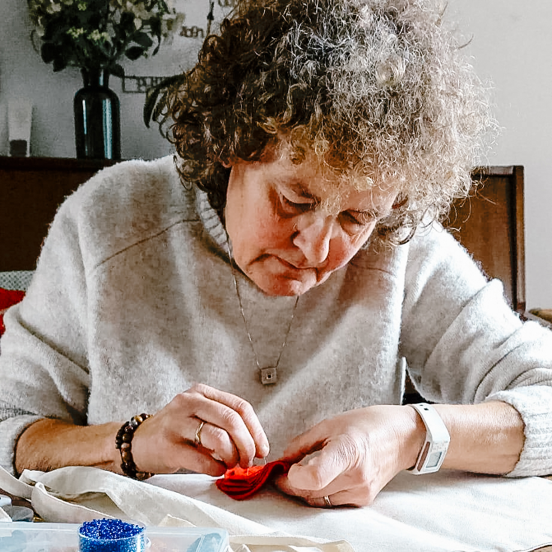

+++
title = 'About me & ordering'
description = ''

[menus.main]
  name = 'About'
  weight = 30
+++

{.img-half}

## Hello, I’m Lucia

My name is Lucia Dewitte. Woven into Luz y lucha are not only my convictions, but also a little piece of my name. Luz y lucha grew out of a playful combination of the Spanish words luz (light) and lucha (struggle). Two words that, together, sound almost like my own name. A happy coincidence, but above all two notions that, for me, are inextricably linked.

Luz. Light.

Luz stands for beauty, hope, warmth and connection. For the little things that make life special. A child’s first word, handwriting you would recognise among thousands, a colour that makes you happy or a memory you want to cherish.

Lucha. Struggle.

Because beauty, hope and humanity can’t always be taken for granted. Sometimes you have to stand up for them. Sometimes it takes resistance: against injustice, against indifference, against a world in which everything has to be ever faster, cheaper and more disposable.

And that resistance doesn’t always have to be loud. I choose to wage it, among other ways, with needle and thread.

That’s actually not so unusual at all. Throughout history, women in particular have used textiles and embroidery to make their voices heard. From the Chilean arpilleras during Pinochet’s dictatorship to the embroidered stories of women in South Africa and the banners of the suffragettes. What was often seen as a well-behaved, domestic pastime turned out to be a powerful way to denounce injustice, show solidarity and preserve stories.

That history inspires me. With Luz y Lucha, I want to build on that tradition in my own modest way.

By giving old clothes a second life instead of throwing them away. By choosing handcraft and unique creations in a world of mass production. By making memories tangible instead of letting them be lost.

But also, at times, by very deliberately weaving a political message into my work. A watermelon and a dove of peace as symbols of solidarity with Palestine. A black-and-white brooch that raises questions about how we look at the world.

Not every piece needs to carry a message. Sometimes I just want to make something beautiful, something playful, colourful or a little absurd. Because beauty, humour and wonder deserve their place too.

For me, those two sides don’t exclude each other. Quite the contrary. Light is what I long for. Struggle is what is sometimes needed to protect that light. And somewhere between the two, Luzylucha comes to life.

Made with care. With room for imperfection. With love for the craft and a healthy dose of quirkiness. No mass production. No throwaway stuff. Never the same thing twice. Instead, small creations with a story of their own, sometimes soft and moving, sometimes rebellious and outspoken.

Luz y Lucha – a little beauty, a little rebellion and, above all, lots of thread.

## Ordering {#order}

Would you like one of my [creations](../works/) or do you have an idea for a personalised gift? Here’s how it works:

1. **Get in touch** on Instagram ([@luzylucha](https://www.instagram.com/luzylucha/)) and tell me what you’re looking for.
2. **We discuss together** the design, colours, price and timing.
3. **I get to work** and keep you posted on the progress.
4. **You receive your creation**, beautifully wrapped and ready to give.

Made-to-measure pieces take a few weeks, depending on the size of the design. Need it by a certain date? Just let me know.
