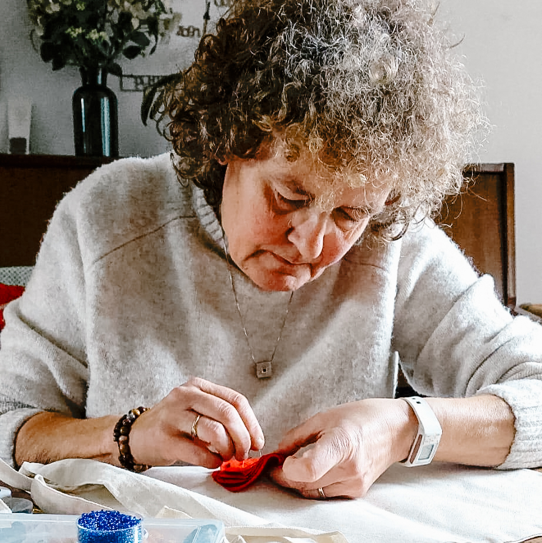

+++
title = 'À propos & commandes'
description = ''

[menus.main]
  name = 'À propos'
  weight = 30
+++

{.img-half}

## Bonjour, je suis Lucia

Je m’appelle Lucia Dewitte. Dans Luz y Lucha sont tissées non seulement mes convictions, mais aussi une partie de mon nom. Luz y lucha est né d’une combinaison ludique des mots espagnols luz (lumière) et lucha (lutte). Deux mots qui, ensemble, sonnent presque comme mon propre nom. Un heureux hasard, mais surtout deux notions qui, pour moi, sont indissociables.

Luz. Lumière.

Luz représente la beauté, l’espoir, la chaleur et le lien. Les petites choses qui rendent la vie précieuse. Le premier mot d’un enfant, une écriture que l’on reconnaîtrait entre mille, une couleur qui vous rend joyeux ou un souvenir que vous voulez chérir.

Lucha. Lutte.

Car la beauté, l’espoir et l’humanité ne vont pas toujours de soi. Parfois, il faut les défendre. Parfois, cela demande de la résistance : contre l’injustice, contre l’indifférence, contre un monde où tout doit aller toujours plus vite, coûter toujours moins cher et être toujours plus jetable.

Et cette résistance n’a pas besoin d’être bruyante. J’ai choisi de la mener, entre autres, avec du fil et une aiguille.

Ce n’est d’ailleurs pas si inhabituel. À travers l’histoire, ce sont surtout les femmes qui ont utilisé le textile et la broderie pour faire entendre leur voix. Des arpilleras chiliennes sous la dictature de Pinochet aux récits brodés des femmes d’Afrique du Sud, en passant par les banderoles des suffragettes. Ce que l’on considérait souvent comme un passe-temps sage et domestique s’est révélé être un moyen puissant de dénoncer l’injustice, de montrer sa solidarité et de préserver des histoires.

Cette histoire m’inspire. Avec Luz y Lucha, je veux prolonger cette tradition, à ma manière et modestement.

En donnant une seconde vie à de vieux vêtements plutôt que de les jeter. En choisissant le fait main et des créations uniques dans un monde de production de masse. En rendant les souvenirs tangibles plutôt que de les laisser se perdre.

Mais aussi, parfois, en intégrant très consciemment un message politique dans mon travail. Une pastèque et une colombe de la paix comme symboles de solidarité avec la Palestine. Une broche en noir et blanc qui interroge notre manière de regarder le monde.

Toutes mes créations ne doivent pas forcément porter un message. Parfois, j’ai simplement envie de créer quelque chose de beau, de ludique, de coloré ou d’un peu absurde. Car la beauté, l’humour et l’émerveillement méritent eux aussi leur place.

Pour moi, ces deux facettes ne s’excluent pas. Au contraire. La lumière est ce à quoi j’aspire. La lutte est ce qui est parfois nécessaire pour protéger cette lumière. Et quelque part entre les deux naît Luz y Lucha.

Fait avec attention. Avec de la place pour l’imperfection. Avec l’amour du métier et une bonne dose de singularité. Pas de production de masse. Pas d’objets jetables. Jamais deux fois la même chose. Mais de petites créations qui ont leur propre histoire, parfois douces et émouvantes, parfois rebelles et engagées.

Luz y Lucha – un peu de beauté, un peu de rébellion et surtout beaucoup de fil.

## Commander {#order}

Vous souhaitez l’une de mes [créations](../works/) ou vous avez une idée de cadeau personnalisé ? Voici comment procéder :

1. **Contactez-moi** sur Instagram ([@luzylucha](https://www.instagram.com/luzylucha/)) et dites-moi ce que vous cherchez.
2. **Nous discutons ensemble** du design, des couleurs, du prix et du délai.
3. **Je me mets au travail** et vous tiens informé·e de l’avancement.
4. **Vous recevez votre création**, joliment emballée et prête à offrir.

Comptez quelques semaines pour une création sur mesure, selon la taille du motif. Vous en avez besoin pour une date précise ? N’hésitez pas à me le dire.
