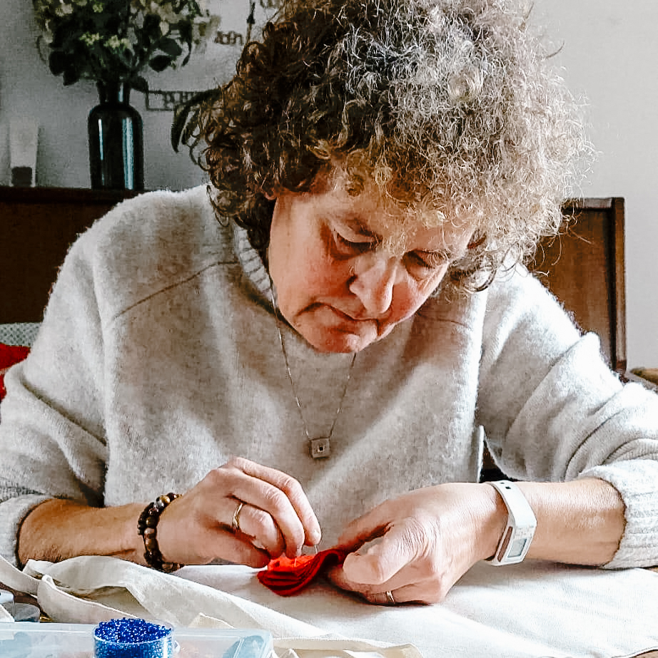

+++
title = 'Over mij & bestellen'
description = ''

[menus.main]
  name = 'Over mij'
  weight = 30
+++

{.img-half}

## Hallo, ik ben Lucia

Mijn naam is Lucia Dewitte. In Luz y lucha zit niet alleen mijn overtuiging maar ook een stukje van mijn naam in verweven. Luz y lucha ontstond uit een speelse combinatie van de Spaanse woorden luz (licht) en lucha (strijd). Twee woorden die samen bijna als mijn eigen naam klinken. Een gelukkig toeval maar vooral twee begrippen die voor mij onlosmakelijk met elkaar verbonden zijn.

Luz. Licht.

Luz staat voor schoonheid, hoop, warmte en verbondenheid. Voor de kleine dingen die het leven bijzonder maken. Een eerste woordje van een kind, een handschrift dat je uit duizenden herkent, een kleur die je vrolijk maakt of een herinnering die je wil koesteren.

Lucha. Strijd.

Want schoonheid, hoop en menselijkheid zijn niet altijd vanzelfsprekend. Soms moet je ervoor opkomen. Soms vraagt het verzet, tegen onrecht, tegen onverschilligheid, tegen een wereld waarin alles steeds sneller, goedkoper en vervangbaarder moet.

En dat verzet hoeft niet altijd luid te zijn. Ik kies ervoor om het onder andere met naald en draad te voeren.

Dat is trouwens helemaal niet zo ongewoon. Doorheen de geschiedenis gebruikten vooral vrouwen textiel en borduurwerk om hun stem te laten horen. Van de Chileens arpilleras tijdens de dictatuur van Pinochet tot de geborduurde verhalen van vrouwen in Zuid-Afrika en de spandoeken van de suffragettes. Wat vaak als een braaf, huiselijk tijdverdrijf werd beschouwd, bleek ook een krachtig middel om onrecht aan te klagen, solidariteit te tonen en verhalen te bewaren.

Die geschiedenis inspireert me. Met Luz y lucha wil ik op mijn eigen, bescheiden manier aan die traditie verder bouwen.

Door oude kledingstukken een tweede leven te geven, in plaats van ze weg te gooien. Door te kiezen voor handwerk en unieke creaties in een wereld van massaproductie. Door herinneringen tastbaar te maken, in plaats van ze verloren te laten gaan.

Maar ook door soms heel bewust een politieke boodschap te verwerken in mijn werk. Een watermeloen en een vredesduif als symbolen van solidariteit met Palestina. een zwart-witte broche die vragen oproept over hoe we naar de wereld kijken.

Niet elk werkstuk hoeft een boodschap te dragen. Soms wil ik gewoon iets moois maken, iets speels, kleurrijks of een beetje absurd. Want ook schoonheid, humor en verwondering verdienen hun plaats.

Voor mij sluiten die twee kanten elkaar niet uit. Integendeel. Licht is waar ik naar verlang. Strijd is wat soms nodig is om dat licht te beschermen. En ergens tussen die twee ontstaat Luz y lucha.

Met aandacht gemaakt. Met ruimte voor imperfectie. Met liefde voor het ambacht en een gezonde dosis eigenzinnigheid. Geen massaproductie. Geen wegwerpspullen. Geen twee keer hetzelfde. Wel kleine creaties met een eigen verhaal, soms zacht en ontroerend, soms rebels en uitgesproken.

Luz y lucha - een beetje schoonheid, een beetje rebellie en vooral veel draad.

## Bestellen {#order}

Wil je een van mijn [creaties](../works/) of heb je een idee voor een gepersonaliseerd cadeau? Zo gaat het in zijn werk:

1. **Neem contact op** via Instagram ([@luzylucha](https://www.instagram.com/luzylucha/)) en vertel me wat je zoekt.
2. **We bespreken samen** het ontwerp, de kleuren, de prijs en de timing.
3. **Ik ga aan de slag** en hou je op de hoogte van de vorderingen.
4. **Je ontvangt je creatie**, mooi verpakt en klaar om cadeau te doen.

Reken voor werk op maat op enkele weken, afhankelijk van de grootte van het ontwerp. Heb je het voor een bepaalde datum nodig? Laat het me zeker weten.
